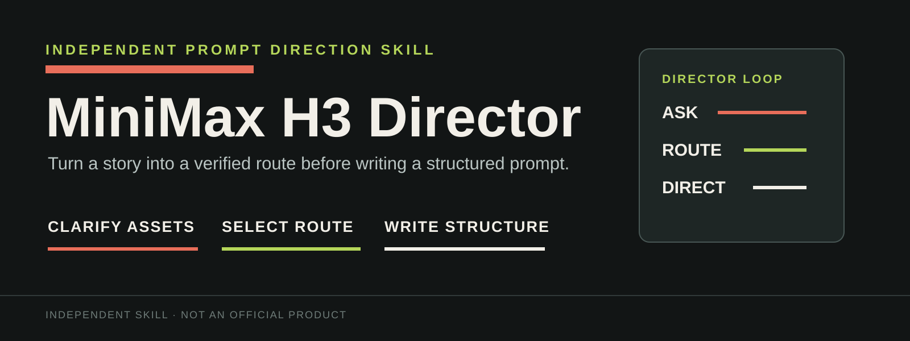
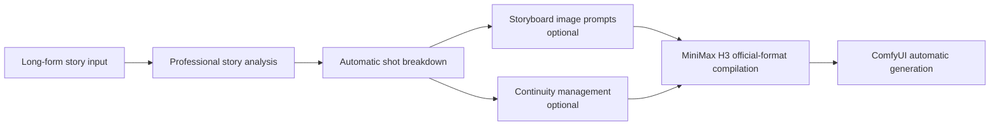

<p align="center">
  
</p>

<p align="center">
  <a href="./README.md">中文</a> · <a href="#license-and-attribution">Apache-2.0</a> · <a href="#roadmap">Roadmap</a>
</p>

<p align="center">
  
  <strong>&nbsp;×&nbsp;</strong>
  
  <strong>&nbsp;×&nbsp;</strong>
  
</p>

# MiniMax H3 Director

An independent prompt-direction skill for Claude Code, Codex, and compatible agents. It turns an underspecified story, reference assets, and delivery target into a structured video prompt suitable for MiniMax H3, but only after it has established what the user actually means.

> This is not an official MiniMax product. The MiniMax icon is used only to describe compatibility; the prompt-engineering and clapperboard icons are separate assets. The three icons do not form an official MiniMax combined mark and do not imply partnership, endorsement, or affiliation.

## Ask before routing

This local ExoHarness adaptation adds one-idea short-drama planning, cross-clip continuity, and instructions for using authorized video MCP tools. The upstream installation commands below install the original version, not these local additions. This copy has not been imported into the production service.

Users do not need to know the acronyms. A picture described only as a reference is treated as a semantic visual reference, not automatically as frame zero. The skill asks a short question only when an unresolved ambiguity would change execution.

- **T2VA**: a story or text concept only, for text-to-audiovisual generation.
- **I2VA**: one image must become the opening frame, for first-frame-driven generation.
- **FL2VA**: opening and ending images are both supplied, for first-and-last-frame-driven generation.
- **L2VA**: only a desired final image is supplied, for last-frame-driven generation.
- **R2V / full-reference**: character, style, motion, video, or voice assets are semantic references.

## Before / after preview

These local demonstration clips can be opened by selecting a preview. The GIFs are compressed previews, not a benchmark and not a claim that every video task will improve by the same amount.

<p align="center">
  <a href="./assets/demos/without-director.mp4"></a>
  <a href="./assets/demos/with-director.mp4"></a>
</p>
<p align="center"><sub>Without Director &nbsp; | &nbsp; With Director</sub></p>

## Install and invoke

**Codex**

```powershell
git clone https://github.com/instann/minimax-h3-director.git "$env:USERPROFILE\.codex\skills\minimax-h3-director"
```

**Claude Code / Claude Desktop compatible directory**

```powershell
git clone https://github.com/instann/minimax-h3-director.git "$env:USERPROFILE\.claude\skills\minimax-h3-director"
```

Example:

```text
Use $minimax-h3-director to turn this wuxia chase into an 8-second video. I have a character reference image and one line of Chinese dialogue.
```

The original skill returns a route, asset-role map, and H3 prompt. This local adaptation can also plan a whole short drama and its clip-by-clip shots. It calls an authorized MCP only when the user requests a rendered video and the necessary generation and assembly capabilities are available. Dialogue and visible on-screen text remain in their original language.

## Current scope

- **Plain-language intake and mode routing**: available.
- **T2VA / I2VA / FL2VA / L2VA prompt writing**: available.
- **R2V / full-reference prompt writing**: available.
- **Structured constraints for shots, dialogue, ambience, and music**: available.
- **One-idea short-drama outline, complete shot plan, and cross-clip continuity**: instructions added in this local adaptation.
- **Authorized video MCP execution when requested**: instructions added locally; real rendering depends on the live schema, permissions, and available assembly path and has not been verified in production.
- **Direct automatic ComfyUI execution**: remains an upstream roadmap item.

## Layout

```text
SKILL.md                         Skill entry point, intake principles, output rules
agents/openai.yaml               Codex UI metadata
references/
  intake-and-routing.md          Plain-language intake and mode decisions
  base-modes.md                  T2VA, I2VA, FL2VA, and L2VA guidance
  reference-mode.md              R2V / full-reference guidance
  prompt-spec.md                 Shot, dialogue, audio, and label rules
  short-drama-production.md      Story planning and continuity
  video-mcp-execution.md         MCP execution, recovery, and final delivery
  official-resources.md          Official links and licensing boundary
assets/
  brand/                          Three independently arranged README icons
  minimax-h3-director-*.svg      Banner and skill UI graphics
  demos/                         README previews and source MP4s
```

## Roadmap

The diagram below is the original upstream roadmap. This local adaptation adds short-drama planning and conditional use of registered MCP tools, but it does not implement a direct ComfyUI controller.



- [ ] Professional analysis of long-form stories
- [ ] Automatic, editable shot lists
- [ ] Storyboard image prompts
- [ ] Cross-shot character, prop, and temporal continuity management
- [ ] H3 official-format compiler
- [ ] ComfyUI workflow mapping and automatic generation

## License and attribution

Original code, documentation, and graphics authored for `minimax-h3-director` are licensed under [Apache-2.0](./LICENSE); see [NOTICE](./NOTICE).

The MiniMax H3 model, official guides, and Documentation are governed by the [MiniMax H3 Community License Agreement](https://huggingface.co/MiniMaxAI/MiniMax-H3/blob/main/LICENSE), not Apache-2.0. This repository does not copy or redistribute those official guides. It supplies links plus independently written operational guidance. Read and comply with the official license, including its territory, redistribution, and acceptable-use terms before using MiniMax H3. The MiniMax graphical mark in `assets/brand/minimax.png` is also excluded from Apache-2.0 and remains the property of its respective owner.

`MiniMax` and `MiniMax H3` are marks of their respective owner. Their names are used only to describe compatibility and do not imply partnership, endorsement, or affiliation.
