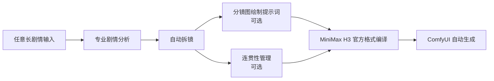

<p align="center">
  
</p>

<p align="center">
  <a href="./README.en.md">English</a> · <a href="#许可与归属">Apache-2.0</a> · <a href="#路线图">路线图</a>
</p>

<p align="center">
  
  <strong>&nbsp;×&nbsp;</strong>
  
  <strong>&nbsp;×&nbsp;</strong>
  
</p>

# MiniMax H3 Director

面向 Claude Code、Codex 及兼容 Agent 的独立提示词导演技能。它先把模糊的剧情、参考素材和出片目标问清楚，再把需求路由为适合 MiniMax H3 的结构化视频提示词。

> 本目录是 ExoHarness 本地扩展版：新增一句话短剧规划、跨段连续性与按需调用已授权视频 MCP 的指引。以下原上游安装命令只安装原版，不包含本地扩展；本目录尚未导入线上服务。

> 非 MiniMax 官方产品。页面中的 MiniMax 图标仅用于说明兼容性；提示词与场记板图标均为独立资源。三个图标不构成 MiniMax 官方组合标识，也不表示合作、背书或隶属关系。

## 为什么先问再写

`T2VA`、`I2VA`、`FL2VA`、`L2VA` 和 `R2V` 不是用户必须预先掌握的术语。技能被加载后，会先用自然语言确认：素材在视频中是实际首尾帧，还是角色/画风/音色参考；然后再补齐时长、画幅、剧情、台词和交付目标。信息不足时不会猜测，更不会一股脑生成提示词。

- **T2VA**：只有剧情或文字设想时，纯文本生成视听片段。
- **I2VA**：一张图必须成为开场画面时，采用首帧驱动。
- **FL2VA**：开场和收束画面各一张时，采用首尾帧驱动。
- **L2VA**：只给最终落点画面时，采用尾帧驱动。
- **R2V / full-reference**：角色、风格、动作、视频或音色属于参考素材时，采用参考生视频。

只说“参考图片”时，本地扩展版按视觉参考处理，不自动锁定首帧；确实无法判断且会改变执行方式时才追问。

## 视频对比

下方为同一类视频任务的本地演示素材。点击预览可打开原始 MP4；动图为压缩预览，不是基准测试，也不代表所有提示词任务都会获得相同比例的改善。

<p align="center">
  <a href="./assets/demos/without-director.mp4"></a>
  <a href="./assets/demos/with-director.mp4"></a>
</p>
<p align="center"><sub>未使用 Director &nbsp; | &nbsp; 使用 Director</sub></p>

## 安装与调用

**Codex**

```powershell
git clone https://github.com/instann/minimax-h3-director.git "$env:USERPROFILE\.codex\skills\minimax-h3-director"
```

**Claude Code / Claude Desktop 兼容目录**

```powershell
git clone https://github.com/instann/minimax-h3-director.git "$env:USERPROFILE\.claude\skills\minimax-h3-director"
```

然后直接说出你的目标，例如：

```text
用 $minimax-h3-director 把这段武侠追逐戏变成 8 秒视频；我有角色参考图和一句中文台词。
```

原版会给出任务路线、素材角色和 H3 提示词。本地扩展版还能先写完整短剧剧情和逐段分镜；只有用户要求出片、并具备已授权且就绪的视频及必要合成能力时，才实际调用 MCP。对话与画面文字保持原语言。

## 当前能力

- **非术语化需求问询与模式路由**：已提供。
- **T2VA / I2VA / FL2VA / L2VA 提示词编写**：已提供。
- **R2V / full-reference 提示词编写**：已提供。
- **镜头、台词、音效和音乐的结构化约束**：已提供。
- **一句话扩写短剧、一次规划全片分镜、跨段状态延续**：本地扩展版已提供指引。
- **按需调用已登记的视频 MCP**：本地扩展版已提供调用/恢复指引；实际出片取决于授权、实时 Schema 和可用的衔接/合成能力，尚未在线上验证。
- **直接自动调用 ComfyUI 工作流**：原上游路线图中；本地扩展版不声称已实现。

## 目录

```text
SKILL.md                         技能入口、问询原则与产出要求
agents/openai.yaml               Codex UI 元数据
references/
  intake-and-routing.md          非术语化问询和模式判断
  base-modes.md                  T2VA、I2VA、FL2VA、L2VA 写法
  reference-mode.md              R2V / full-reference 写法
  prompt-spec.md                 镜头、台词、声景与标签约束
  short-drama-production.md      剧情分段与连续性规划
  video-mcp-execution.md         按需调用 MCP、恢复与成片交付
  official-resources.md          官方资料链接与许可证边界
assets/
  brand/                          README 中独立排列的三个图标
  minimax-h3-director-*.svg      横幅与技能 UI 图形
  demos/                         README 对比预览与原始 MP4
```

## 路线图

下面是原上游目标全链路；本地扩展版增加了短剧规划与已登记 MCP 的按需调用指引，但没有实现独立的 ComfyUI 自动控制器。



- [ ] 任意长剧情的专业剧情分析
- [ ] 自动拆镜与可编辑分镜表
- [ ] 分镜图绘制提示词
- [ ] 跨镜头角色、道具和时空连贯性管理
- [ ] H3 官方格式编译器
- [ ] ComfyUI 工作流参数映射与自动生成

## 许可与归属

本仓库中由 `minimax-h3-director` 作者原创的代码、文档和图形采用 [Apache-2.0](./LICENSE) 许可，详见 [NOTICE](./NOTICE)。

MiniMax H3 的官方模型、官方指南及其 Documentation 采用 [MiniMax H3 Community License Agreement](https://huggingface.co/MiniMaxAI/MiniMax-H3/blob/main/LICENSE)，并非 Apache-2.0。本仓库不复制或再分发这些官方指南，只提供访问链接和独立编写的操作说明；使用 MiniMax H3 前请自行阅读并遵守该许可及其地域、再分发和可接受使用要求。`assets/brand/minimax.png` 中的 MiniMax 图形标识同样不受 Apache-2.0 覆盖，权利归其权利人所有。

`MiniMax` 和 `MiniMax H3` 是其权利人的标识。本仓库仅为兼容性说明而使用名称，不表示合作、背书或隶属关系。
